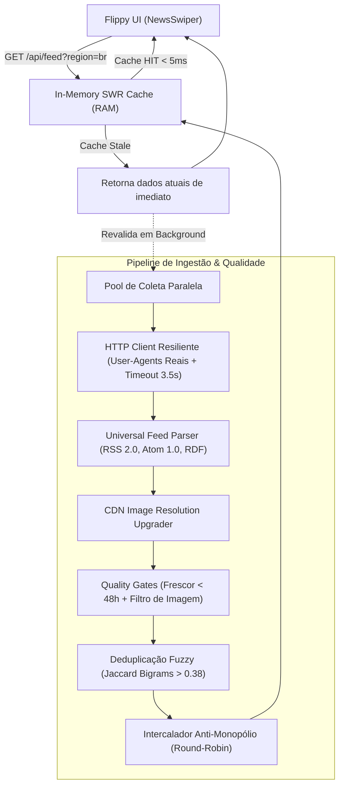

# Flippy v2 - Arquitetura e Engenharia do Motor de Notícias

## 1. Visão Geral da Mudança (v1 vs v2)

A versão inicial (v1) dependia de intermediários de RSS (`rss.app`), scraping manual de HTML via regex em páginas com Cloudflare/paywalls, e concorrência pesada com banco de dados Supabase via Server Actions e `after()`. Isso gerava lentidão, feeds desatualizados e falhas de carregamento de imagens.

A **v2-clean** reestruturou o núcleo do Flippy com os seguintes princípios:
1. **Zero Chaves de API**: Coleta 100% autônoma a partir de fontes públicas, sem custo, sem cotas que expiram e sem necessidade de cadastro em serviços terceiros.
2. **Alta Resiliência e Desacoplamento**: Eliminação da dependência obrigatória de banco externo para leitura de notícias.
3. **Quality Gates Rígidos**: Nenhuma notícia sem imagem de alta qualidade ou desatualizada (> 48h) chega à interface.
4. **Performance Sub-20ms**: Cache em memória com arquitetura SWR (*Stale-While-Revalidate*) nativa no Next.js.
5. **Interface Minimalista & Imersiva**: Experiência tela cheia estilo TikTok/Stories, com todas as configurações concentradas no ícone discreto de engrenagem.

---

## 2. Diagrama de Fluxo do Motor de Notícias



---

## 3. Módulos do Sistema (`src/lib/news-engine/`)

### 3.1 `http-client.ts`
- Rotação de `User-Agent` de navegadores reais (Chrome, Safari, Firefox).
- Headers HTTP completos (`Accept`, `Accept-Language`, `Cache-Control`) para evitar bloqueios HTTP 403 e WAFs.
- Execução isolada com timeout agressivo de 3.5 segundos por fonte via `AbortController`. Falhas em uma fonte não travam as outras.

### 3.2 `feed-parser.ts`
- **Suporte Multiformato**: Processa RSS 2.0, Atom 1.0 e RDF.
- **Cascata Polimórfica de Imagens**:
  1. `<media:content url="...">`
  2. `<media:thumbnail url="...">`
  3. `<imagem-destaque>...</imagem-destaque>` (ex: Agência Brasil / EBC)
  4. `<enclosure url="..." type="image/...">`
  5. Scraper inteligente no corpo HTML de `<content:encoded>` e `<description>`.
- **CDN Resolution Upgrader**: Converte automaticamente miniaturas de baixa resolução para Full HD em publishers conhecidos (ex: BBC `/240/` para `/1024/`, G1 `/300x200/` para `/940x/`).
- **Limpeza Semântica**: Remove tags HTML, resíduos de CDATA, entidades HTML (`&quot;`, `&#8220;`, etc.) e rodapés de autopromoção (*"Leia mais no..."*).
- **Truncamento Inteligente**: Resumos otimizados entre 140 e 220 caracteres, cortando preferencialmente no último ponto final de frase.

### 3.3 `quality-gate.ts`
- **Filtro de Frescor**: Descarte estrito de notícias com mais de 48 horas de publicação.
- **Filtro de Integridade de Mídia**: Elimina imagens com padrões de tracking pixels (`1x1`, `pixel`, `spacer.gif`), favicons (`16x16`) ou placeholders corrompidos.
- **Deduplicação Fuzzy (Jaccard Similarity)**: Analisa bigramas de títulos limpos de stopwords. Notícias sobre o mesmo fato não são duplicadas na timeline; a fonte secundária é anexada ao campo `relatedSources` (*"Também coberto por: BBC, CNN"*).
- **Intercalador Anti-Monopólio**: Algoritmo Round-Robin que impede que um único portal domine a sequência de cards.

### 3.4 `discovery.ts`
- **Auto-Discovery por Domínio**: Acessa qualquer URL digitada pelo usuário e extrai a tag `<link rel="alternate" type="application/rss+xml">` automaticamente.
- **Busca Aberta por Tópico**: Suporte ao índice aberto do Google News por palavra-chave para cobrir qualquer tema em tempo real.

### 3.5 `engine.ts`
- Orquestrador principal mantendo cache singleton em `globalThis.__flippy_news_cache__`.
- **Fresh TTL (4 minutos)**: Resposta instantânea da memória.
- **Stale Grace Period (1 hora)**: Resposta imediata com dados existentes enquanto revalida silenciosamente em background.

---

## 4. Contrato de Dados Padronizado (`CleanArticle`)

```typescript
export interface CleanArticle {
  id: string;
  title: string;
  summary: string;
  description?: string;
  imageUrl: string;
  originalUrl: string;
  sourceName?: string;
  brandColor?: string;
  source: {
    id: string;
    name: string;
    slug: string;
    brandColor?: string;
  };
  publishedAt: string;         // ISO 8601 UTC
  relativeTime?: string;        // "agora mesmo", "há 15 min", "há 2 h"
  category: string;
  region: 'br' | 'world';
  relatedSources?: Array<{ name: string; url: string }>;
}
```

---

## 5. Interface & Experiência de Usuário (UI/UX)

- **Layout Imersivo 9:16**: Imagem preenchendo a tela inteira com overlay degradê escuro duplo (`from-black/95 via-black/50 to-black/10`).
- **Navegação Limpa**: Barra superior simplificada com logo e ícone de engrenagem.
- **Menu Lateral (`FeedManager.tsx`)**:
  - Seletor de foco: **🌟 Em Destaque**, **🇧🇷 Brasil**, **🌍 Internacional** e **💻 Tecnologia**.
  - Gerenciador de fontes com cores oficiais, alternância de visibilidade e botão de exclusão.
  - Campo de auto-descoberta para adicionar novos sites apenas pelo domínio.
- **Pré-carregamento Inteligente (`NewsSwiper.tsx`)**: Enquanto o card atual está visível, as imagens dos próximos dois cards são carregadas em background no navegador, eliminando travamentos de transição.


---

## 6. Sistema de Hash Canônico e Feed em Camadas (D-0 vs D-1/D-2)

### 6.1 Identificador Único Compacto (`src/lib/news-engine/hash.ts`)
- **Canonização**: Remove automaticamente parâmetros de tracking (`utm_*`, `at_*`, `fbclid`, etc.) e normaliza a URL.
- **Hash FNV-1a (32-bit)**: Gera um ID determinístico de apenas **8 caracteres hexadecimais** (ex: `f6c2c1b0`).
- **Armazenamento Otimizado**: 1.000 notícias lidas ocupam meros **8 KB** no `localStorage`, com pruning automático em fila circular (FIFO).

### 6.2 Feed em Camadas com Transição Visual
- **Prioridade 1**: Notícias de **Hoje (D-0 / últimas 24h)** ainda não vistas pelo usuário.
- **Card Divisor de Transição**: Quando as notícias de hoje acabam na rolagem, um card com animação suave avisa:
  > *"Você está em dia com as novidades de hoje! 🎉 Deslize para ver as notícias de ontem e dias anteriores..."*
- **Prioridade 2**: Notícias de **Ontem (D-1)** e anteriores ainda não vistas.
- **Detecção de Dwell Time**: Cada notícia só é marcada como vista se o usuário permanecer nela por pelo menos 1.2 segundos (evitando que scrolls rápidos marquem cards acidentalmente).
- **Tela de Conclusão**: Se todas as notícias disponíveis forem consumidas, uma tela especial de parabéns permite rever as notícias lidas ou aguardar novas atualizações.
